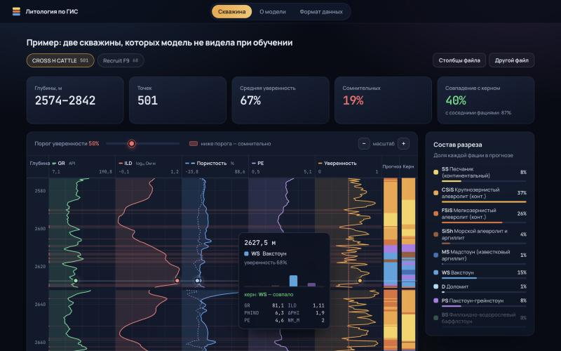

# 🪨 Литология по ГИС — веб-сервис для геофизиков

Сайт, который определяет литофации по каротажным кривым. Геофизик загружает файл скважины
и сразу видит планшет с прогнозом, уверенностью модели и сомнительными интервалами —
и может поправить результат перед выгрузкой.

**Демо:** https://xarebovdavid.github.io/well-log-facies-web/ — нажмите «Попробовать на примере»



## Возможности

- **Модель работает прямо в браузере.** Файл скважины никуда не отправляется, прогноз считается мгновенно.
- **Загрузка CSV, Excel и LAS** перетаскиванием. Столбцы распознаются автоматически, в том числе
  русские названия («ГК», «Глубина», «Пласт»), разделитель `;`, десятичная запятая, кодировка Windows-1251.
  Сопротивление в Ом·м переводится в log₁₀ само; RELPOS считается по кровле и подошве пласта.
- **Интерактивный планшет:** GR, сопротивление, пористость, PE, уверенность модели и колонки фаций.
  При наведении — значения кривых и вероятности всех девяти фаций на этой глубине.
- **Сомнительные интервалы** подсвечиваются; порог уверенности меняется ползунком на лету.
- **Сравнение с керном:** если в файле есть фации по керну, рядом строится колонка «Керн» и матрица ошибок.
- **Решение геолога:** прогноз можно поправить по интервалам и скачать итоговую разметку в CSV.
- **Прозрачность модели:** метрики на скважинах, не участвовавших в обучении,
  какие фации путаются, какие кривые важнее.

## Как это устроено

```
train_model.py         обучение CatBoost, метрики на отложенных скважинах
       ↓
export_web_model.py    выгрузка деревьев в JSON + сверка расчёта с CatBoost
       ↓
docs/                  сайт: HTML, CSS, JavaScript без сборки и фреймворков
```

Модель — CatBoost (500 деревьев глубины 4) на признаках `GR, ILD_log10, DeltaPHI, PHIND, PE, RELPOS, NM_M`.
Разбиение на обучение и проверку — **по скважинам**, чтобы оценка была честной для новой скважины.

Расчёт в браузере (`docs/js/model.js`) повторяет алгоритм CatBoost и сверен с исходной моделью
на всех 3232 интервалах датасета: прогнозы совпадают полностью, вероятности — до 10⁻⁷.

| Метрика на 2 отложенных скважинах | Значение |
|---|---|
| Точное совпадение с керном | 45% |
| Совпадение с точностью до соседней фации | 88% |
| Macro F1 | 0.40 |

## Стек

- **Сайт:** JavaScript (ES-модули), SVG, CSS — без фреймворков; хостинг GitHub Pages
- **Модель:** Python, CatBoost, scikit-learn, pandas

## Запуск локально

Сайт:

```bash
python3 -m http.server 8000 --directory docs     # http://localhost:8000
```

Переобучение и выгрузка модели:

```bash
python3 -m venv .venv
.venv/bin/pip install -r requirements.txt
.venv/bin/python train_model.py
.venv/bin/python export_web_model.py
```

## Структура

| Путь | Что внутри |
|---|---|
| `docs/index.html`, `docs/css/` | страница и оформление |
| `docs/js/app.js` | сценарий сайта: загрузка, интервалы, выгрузка |
| `docs/js/plot.js` | планшет скважины |
| `docs/js/parse.js` | чтение CSV / Excel / LAS, распознавание столбцов |
| `docs/js/model.js` | расчёт модели в браузере |
| `train_model.py`, `export_web_model.py` | обучение и выгрузка модели |
| `app.py` | первая версия сайта на Streamlit ([демо](https://well-log-facies.streamlit.app)) |
| `data/`, `models/` | датасет и обученная модель |

## Команда и источники

Проект выполнен в команде в рамках задачи «Классификация литологии по данным ГИС».

- Модель и исследование данных — командный репозиторий:
  [denfom4/-------mlt](https://github.com/denfom4/-------mlt)
- Моя часть — веб-сервис: интерфейс, перенос модели в браузер, загрузка и проверка данных,
  визуализация, выгрузка результатов.
- Данные: [Well log facies dataset](https://www.kaggle.com/datasets/imeintanis/well-log-facies-dataset) (Kaggle),
  скважины месторождения Hugoton–Panoma, Канзас.
