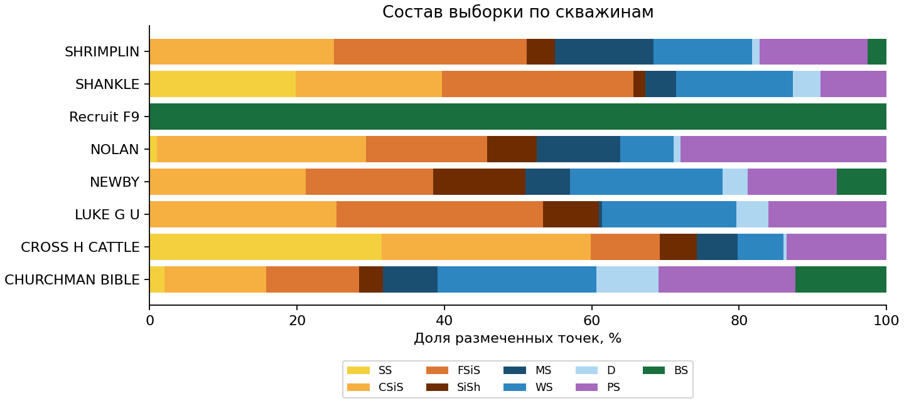
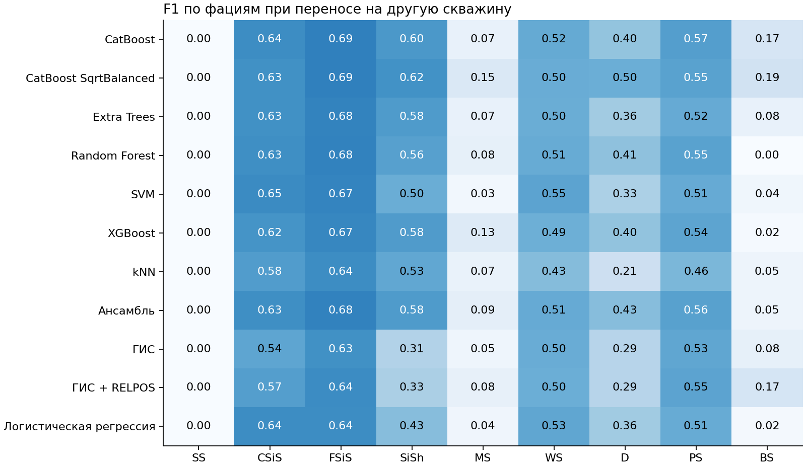
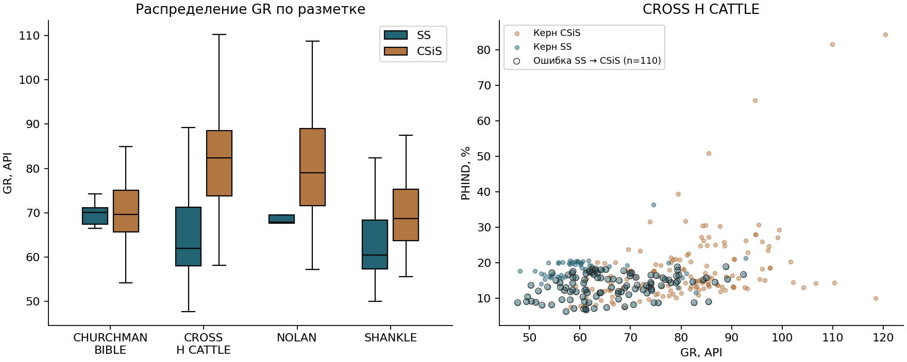

# Как меняется распознавание фаций при переходе на другую скважину

На шести скважинах разработки лучшую F1 по пяти каротажным признакам текущая модель получила для мелкозернистого алевролита FSiS (0,63). Морские алевролиты и аргиллиты SiSh особенно чувствительны к информации об обстановке осадконакопления. Песчаник SS оказался наиболее трудным при переносе. Ни один из проверенных вариантов не распознал его на шести скважинах при поочерёдном исключении каждой из обучения.

## Данные и протокол

Одна строка — точка замера с глубиной, значениями кривых и меткой фации. Использована [версия набора данных проекта](../data/facies_data.csv). Для выбора модели взяты 2663 точки шести скважин. В каждом из шести прогонов модель училась на пяти скважинах и предсказывала шестую. Стандартизация признаков для логистической регрессии, SVM и kNN обучалась заново внутри прогона. Все варианты получили одинаковые строки. Глубина и название скважины служили для группировки и анализа.

Основной критерий сравнения — macro F1 по объединённым прогнозам шести прогонов. Каждый из девяти классов имеет равный вес. Точное совпадение по всем точкам характеризует работу на массовых классах. Две ранее изученные отложенные скважины использованы для отдельного разбора переноса. Точки одного разреза пространственно связаны, поэтому число скважин лучше описывает объём независимой проверки, чем число строк.



## Гипотеза 1. Геологический контекст помогает разделять часть фаций

Одинаковый CatBoost последовательно получил пять кривых (GR, ILD_log10, DeltaPHI, PHIND, PE), положение в пласте RELPOS и индикатор континентальной/морской обстановки NM_M.

| Набор входных данных | Macro F1 | Точное совпадение | F1 для SiSh | F1 для FSiS |
|---|---:|---:|---:|---:|
| Кривые ГИС | 0,327 | 48,4% | 0,31 | 0,63 |
| Кривые и RELPOS | 0,348 | 49,8% | 0,33 | 0,64 |
| Кривые, RELPOS и NM_M | 0,406 | 54,8% | 0,60 | 0,69 |

Наибольший прирост у SiSh даёт последний шаг. Для вакстоуна WS F1 на тех же шагах составляет 0,50 → 0,50 → 0,52. Это ограничивает область вывода о пользе контекста. На новой скважине для полного варианта нужны границы пласта или готовый RELPOS и независимо известная обстановка NM_M. Если обстановку определяют по той же фациальной разметке, оценка полного варианта завышает практическую применимость. Происхождение этого признака для предполагаемой производственной скважины требует уточнения.

## Гипотеза 2. Веса классов улучшают распознавание редких фаций

| Модель на полном наборе признаков | Macro F1 | Точное совпадение |
|---|---:|---:|
| CatBoost SqrtBalanced | 0,426 | 54,1% |
| CatBoost сайта | 0,406 | 54,8% |
| Ансамбль CatBoost, Extra Trees и XGBoost | 0,393 | 54,0% |
| XGBoost | 0,383 | 52,4% |
| Random Forest | 0,381 | 53,4% |
| Extra Trees | 0,379 | 52,5% |
| SVM с ядром RBF | 0,365 | 53,7% |
| Логистическая регрессия | 0,354 | 52,0% |
| kNN | 0,330 | 46,6% |

Ансамбль усредняет вероятности трёх моделей с одинаковыми весами. Параметры каждого алгоритма заданы в [скрипте эксперимента](evaluate.py). Результаты относятся к этим конфигурациям. Систематический подбор гиперпараметров потребовал бы внутреннего разбиения по скважинам.



У доломита D (96 точек) веса увеличили полноту с 33% до 48%, точность положительного прогноза с 50% до 52%. Для мадстоуна MS (189 точек) полнота выросла с 5% до 13%, точность положительного прогноза с 11% до 17%. Для MS этого всё ещё мало. У песчаника оба варианта дали 0 верных ответов из 101. Даже среди моделей со скромным общим результатом есть локальные преимущества, например SVM для WS (F1 0,55 против 0,52 у обычного CatBoost).

**Выбор модели.** Для задачи с равным приоритетом девяти фаций лидирует CatBoost SqrtBalanced. Для максимальной доли точных совпадений по всем точкам лидирует текущий CatBoost сайта. Для защиты стоит показать оба критерия. Взвешенный вариант — кандидат для следующей версии. Перед заменой следует проверить его оценки уверенности и подсветку по порогу, поскольку веса изменяют вероятности классов.

## Гипотеза 3. Состав разреза влияет на результат по скважине

Точное совпадение базовой модели в шести прогонах варьирует от 44% на CHURCHMAN BIBLE до 65% на LUKE G U. Для двух ранее отложенных скважин модель обучена на всех шести скважинах разработки.

| Проверочная скважина | Точек | Состав разметки | Верно, CatBoost сайта | Верно, SqrtBalanced |
|---|---:|---|---:|---:|
| CROSS H CATTLE | 501 | Восемь фаций | 201 (40%) | 202 (40%) |
| Recruit F9 | 68 | Все точки относятся к BS | 54 (79%) | 59 (87%) |

При объединении этих скважин macro F1 составляет 0,398 у базовой и 0,413 у взвешенной модели. Разрыв между скважинами нельзя переносить на всё месторождение. На Recruit F9 оценивалось распознавание единственного класса. Доля попаданий базовой модели в точную или заранее указанную соседнюю фацию составляет 88% при точном совпадении 45%. Для геолога различие этих критериев существенно.

## Разбор ошибки SS → CSiS на CROSS H CATTLE

Из 158 точек песчаника базовая модель отнесла 110 к крупнозернистому алевролиту и правильно распознала 39. В обратную сторону произошло 3 ошибки на 142 точках CSiS. Возможное объяснение — различия распределений кривых между скважинами в сочетании с малым числом обучающих примеров песчаника.



На левом графике показаны скважины, где представлены оба класса. Внутри CROSS H CATTLE медианы GR расходятся (62 и 82 API), а центральные 50% значений занимают диапазоны 58–71 и 74–89 API. На CHURCHMAN BIBLE медианы почти одинаковы (70 и 70 API). По пористости на CROSS H CATTLE медианы практически совпадают (15,40 и 15,45%). В точках ошибки SS → CSiS медианы составляют 64 API и 13,6%. Картина согласуется с ограниченной переносимостью границы между классами. Она не доказывает физическую причину ошибки конкретного замера.

Ещё одно ограничение видно в обучающих данных. Из 101 точки песчаника 89 приходятся на SHANKLE. При проверке на SHANKLE для обучения остаются лишь 12 таких точек. Поэтому для следующей проверки особенно ценна скважина с независимо размеченными песчаниками и алевролитами.

## Воспроизведение

Из корня проекта в Python-окружении с зависимостями сайта:

```sh
python -m pip install -r research/requirements.txt
python research/evaluate.py
python research/figures.py
```

Для XGBoost на macOS нужен OpenMP runtime. В использованном окружении путь к libomp из scikit-learn передан через DYLD_FALLBACK_LIBRARY_PATH.

Числа доступны отдельно: [сводка моделей](models.csv), [precision, recall и F1 по фациям](classes.csv), [точность по скважинам](wells.csv), [прогнозы на точках шести скважин](oof.csv), [прогнозы двух вариантов на отложенных скважинах](holdout.csv).
